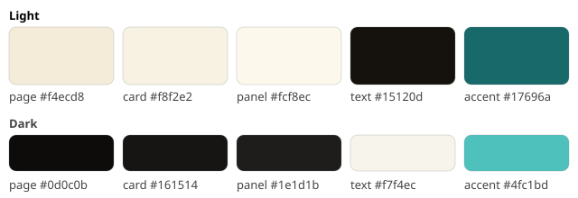

<p align="center"></p>

# Parchment & Ink

A Flexoki-inspired theme mod for the Claude desktop app. By day it is warm beige parchment with near-black ink; by night it is ink-black with soft white text.



## What it does

- **Light mode:** a beige, slightly yellowed page with black text. Cards and panels are a little lighter than the page.
- **Dark mode:** a near-black page with a faint warm tint, layered dark-gray panels and soft white text.
- **Own touches:** a teal accent, and code, git and warning colors tuned separately for each mode so they stay readable.
- It sets colors only. It adds no backdrop, sound or custom fonts.

## Install

At the prompt of a terminal session:

```
/plugin install parchment-ink --marketplace illescasDaniel/parchment-ink-claude-theme
```

From a shell:

```bash
claude plugin install parchment-ink --marketplace illescasDaniel/parchment-ink-claude-theme
```

In the desktop app, where `/plugin` does not run: click + next to the prompt box, then Plugins, Add marketplace with `illescasDaniel/parchment-ink-claude-theme`, then Add plugin.

In a terminal you will be asked `Add marketplace?`: answer `y`, then choose a scope (user scope applies to every session).

## Quick start

Requires the Claude desktop app (Code tab) with mods enabled. Start a session with this folder as a plugin folder:

```bash
claude --plugin-dir "/path/to/Claude Mods/parchment-ink"
```

Or put the folder inside the dev-mods folder your session watches. The theme is applied when a session starts. A full app restart may be needed the first time.

## Customizing

The whole palette is in [`hooks/register.ts`](hooks/register.ts) (`surface-0` is the page, `surface-1` cards, `surface-2` panels). Edit the hex values and reload. [`hooks/make-colors.js`](hooks/make-colors.js) is the skill's color helper, copied unchanged.

## Limits

- Only the desktop and mobile apps draw themes. The terminal and editors ignore it.
- Permission prompts keep the app's own look.
- Checked with `claude plugin validate` and by eye in the desktop app. There are no automated tests. A few minor contrast notes from the color helper (git labels, switch hover) remain, none of which stops the app painting the theme.

## License

MIT. See [LICENSE](LICENSE).
